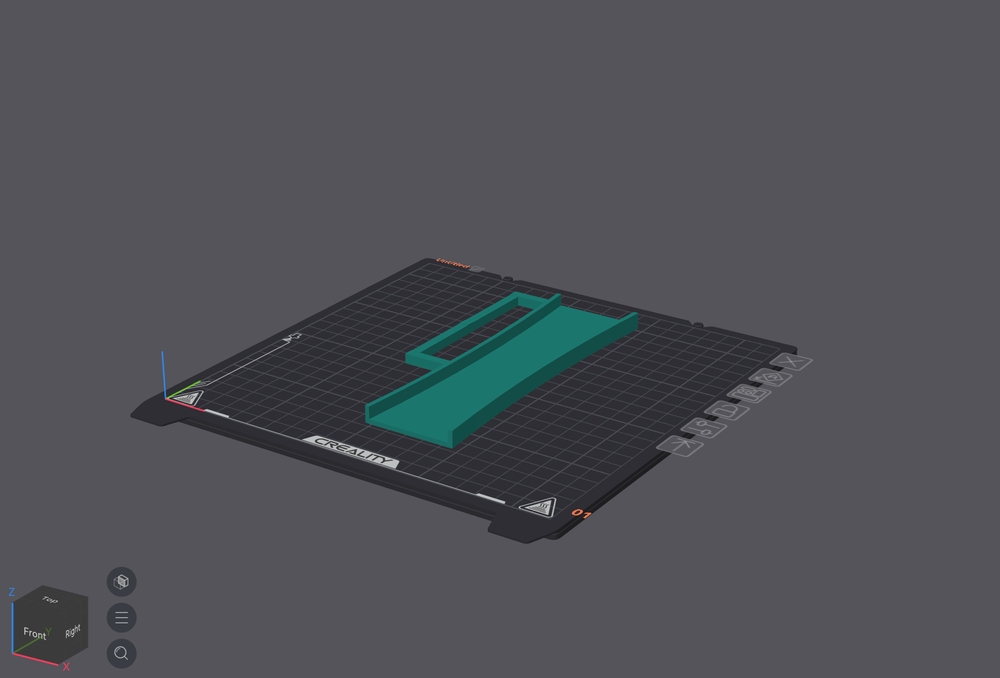
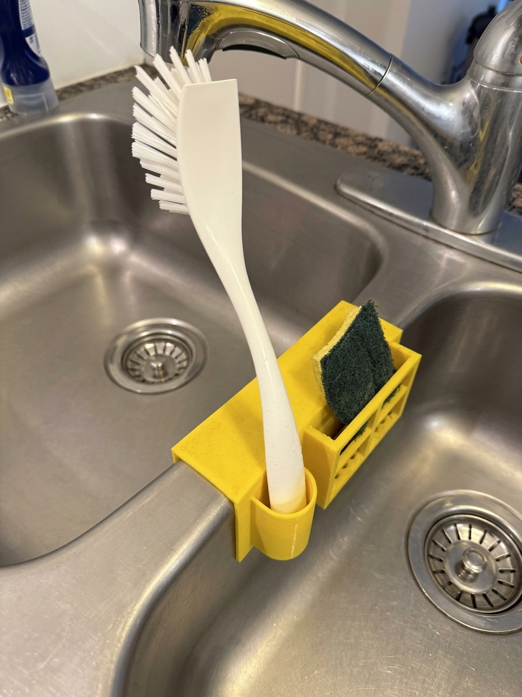

## The problem

After moving out of my parents' home and into my own apartment, I noticed I didn't have a good place to leave my dish sponge and brush. Leaving them on the counter made it wet, and the sponge didn't dry well sitting flat. I wanted somewhere to keep them handy without leaving a puddle after doing the dishes.

## Design

I designed a 3D-printed mount that sits over the divider between my kitchen sinks, with a slot for the brush handle and a small basket for the sponge. I added cutouts along the sides and bottom of the basket so water could drain into the sink and air could reach the sponge.

The holder needed to:

- Hold both the brush and sponge off the countertop.
- Leave openings for drainage and airflow around the sponge.
- Sit properly over the divider despite the sink's curved edges.

## Iteration and fit testing

Getting the fit right took a few iterations. The sink's curved edges made it important to try the printed parts on the actual divider. I used those test fits to see where adjustments were needed, then revised the model until it sat properly.

*A test piece in the slicer, ready to print and check against the sink.*

## The finished holder

Now the brush and sponge have a place to sit between uses. The holder keeps them off the counter, and the basket holds the sponge upright with room for water to drain.

I've also shared the design on Printables in case anyone else has the same problem. It was made to fit my sink, so check the dimensions against yours before printing.

[View and download the Brush and Sponge Holder on Printables](https://www.printables.com/model/1909294-brush-and-sponge-holder)
