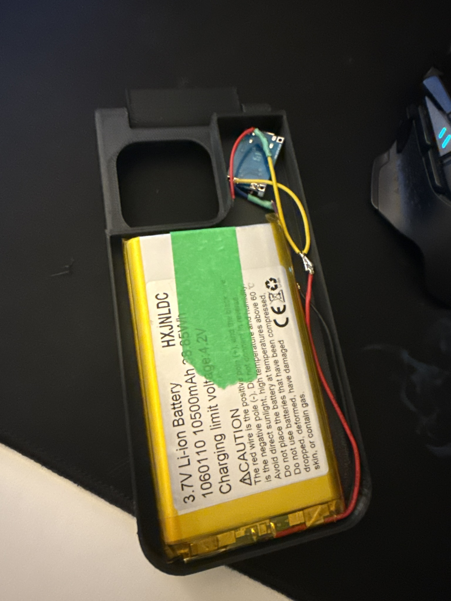
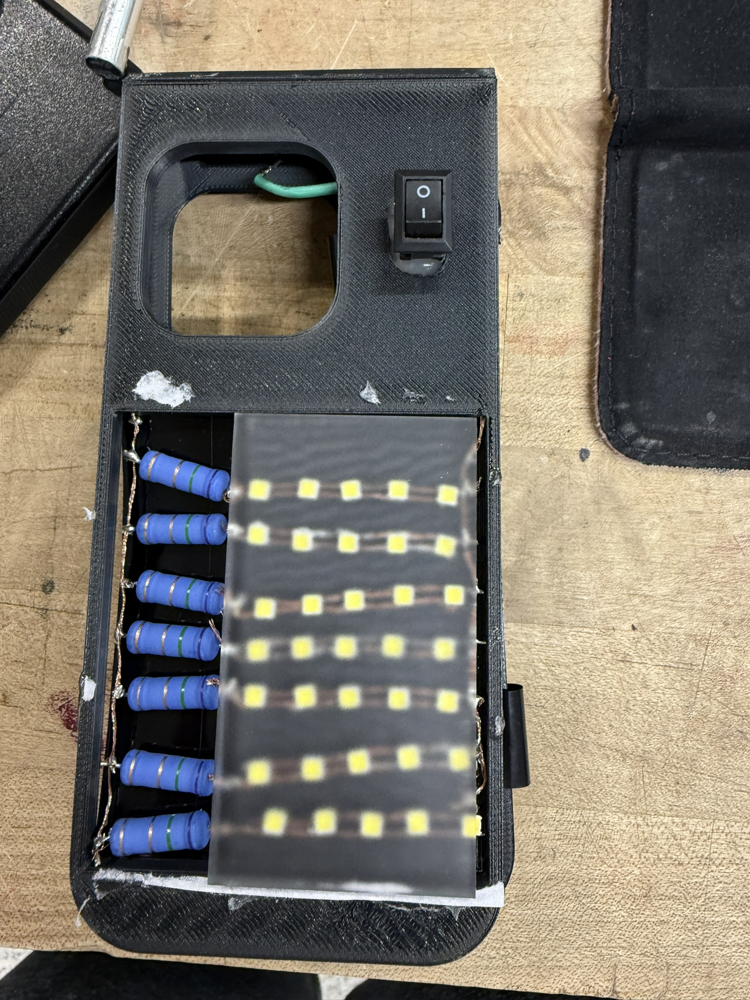
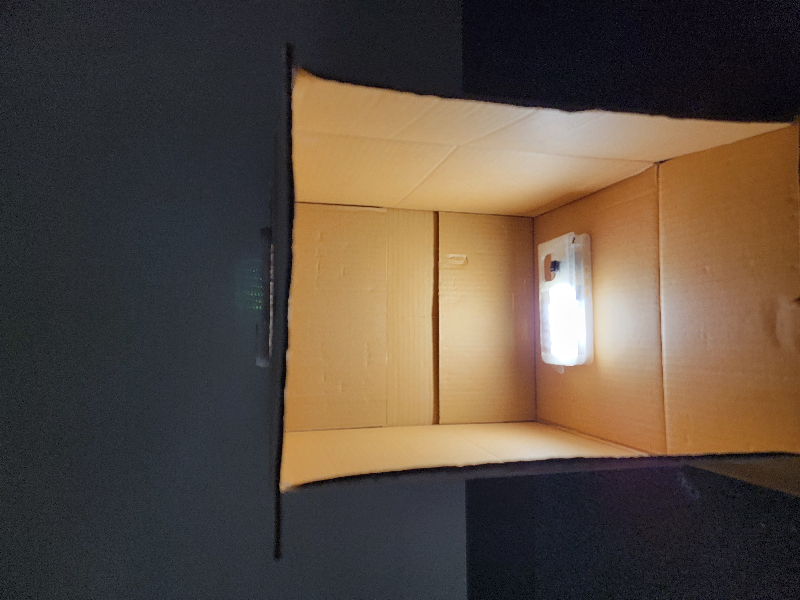

## The problem

For APS112: Engineering Strategies & Practice II, our six-person team explored how a portable light therapy device could fit into an adolescent's morning routine. The project brief focused on the inconvenience of having to stay beside a stationary light box during a busy morning.

One of the early challenges was finding a useful direction in a market already filled with light therapy lamps and sunlight-simulating lighting. We focused on integrating the device into something users already carry and use: their phone.

Our proposed design, **DigiLux**, combined a phone case with a hinged LED panel that could fold above the screen. The case housed its own battery so the panel could operate independently of the phone.

## My role

I led the hands-on technical work on our project, including the CAD modeling, case-material and battery research, and circuit schematic development. I then researched how to build the prototype, sourced the materials, and assembled the hardware, which gave our team a working device for the final showcase.

Alongside this, I took responsibility for the quality of our research. I checked the sources my teammates relied on, confirmed that they actually supported the claims being made, and reviewed the reports to make sure everything was properly cited. I carried this through every stage of the project, from requirements development and concept evaluation to the final design documentation.

## Choosing and packaging the design

The team generated 99 ideas and narrowed them through feasibility screening, voting, and decision charts. We compared three final concepts: a phone case, a neck-worn device, and a drone-mounted light. A Pugh chart supported selecting the phone case for its portability and fit with an existing routine.

I developed the case geometry in SolidWorks around an iPhone 16 Pro, accounting for the camera opening, light panel, hinge, battery, and electronics. The panel needed to fold out while leaving the phone usable, and the battery had to fit within the case. I researched case materials and dimensions alongside the electrical components so the mechanical design could accommodate the hardware we could obtain.

*Battery packaging during assembly and the completed LED panel. Building the hardware exposed constraints that were difficult to judge from CAD alone.*

## Building the electronics

I hand-drew the final circuit design used in the prototype and built it with the components and manufacturing tools available to us. A teammate later recreated the schematic in Altium Designer to make it more presentable. The LEDs we purchased were surface-mount components, but we did not have a printed circuit board for them. I had to solder wires directly to the small LED contacts to assemble the array.

This made soldering and assembly difficult. The hand-wired circuit also had to fit into the printed enclosure alongside the battery, switching hardware, and power electronics. Heat management became another challenge as we increased the light output.

### Brightness versus battery capability

The hardest part was achieving both the required brightness and useful battery life. Our basic circuit required substantial current to drive the LEDs, which was a challenge for the single-cell lithium-polymer battery available to us.

We could reach the project's brightness target using an AC-to-DC wall adapter. The battery could illuminate the panel and power the assembled device, but it could not deliver the same required brightness. Fitting a battery into the case and meeting the lighting target were two separate problems, and our prototype only demonstrated both under different power conditions.

## Testing and the final showcase

The team used a phone-based lux meter and a cardboard enclosure to reduce ambient light during illuminance testing. The final presentation reported readings of **5,400–6,700 lux**, above our **5,000-lux design target**. Those results came from the wall-powered test setup; they do not establish the same output on battery power.

*The light-output test setup. These measurements evaluated prototype illuminance, not clinical effectiveness.*

For the showcase, I delivered a functional, 3D-printed phone case with an illuminated folding panel and its own battery fitted inside. The device operated independently of a wall supply, demonstrating the mechanical packaging and electrical integration.

## What I learned

This project connected mechanical design, electronics, manufacturing, and research in a way that a CAD model alone could not. I took responsibility for turning the concept into physical hardware, then worked through the limitations of the components and assembly methods we had available.

The biggest lesson was to evaluate brightness, current demand, heat, and battery capability together early in development. A battery that fits the enclosure does not necessarily meet the circuit's power requirements, and a light panel that reaches its target on a wall supply does not establish portable performance.

A next iteration would need a purpose-designed PCB, improved LED driving and thermal management, and a battery selected for the measured load. The priority would be to repeat the illuminance test on battery power and measure sustained output and runtime before claiming that the portable device meets the full design target.
