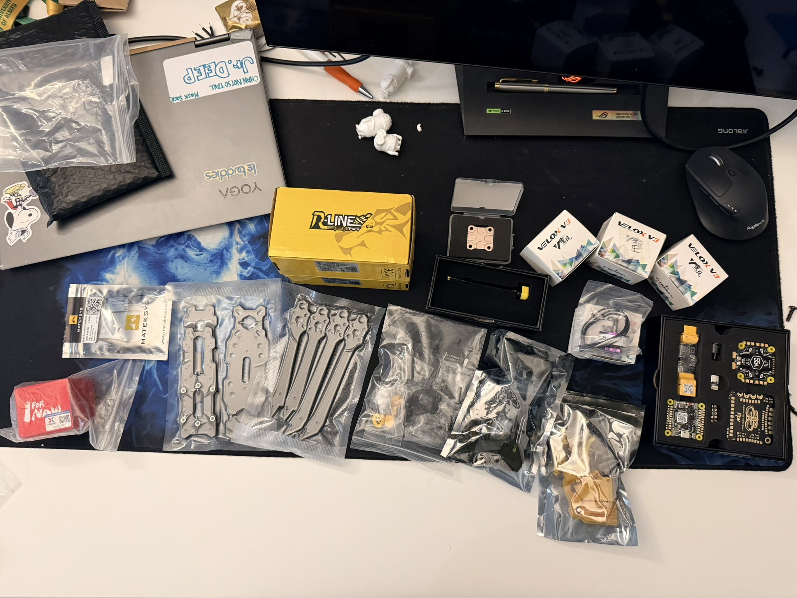
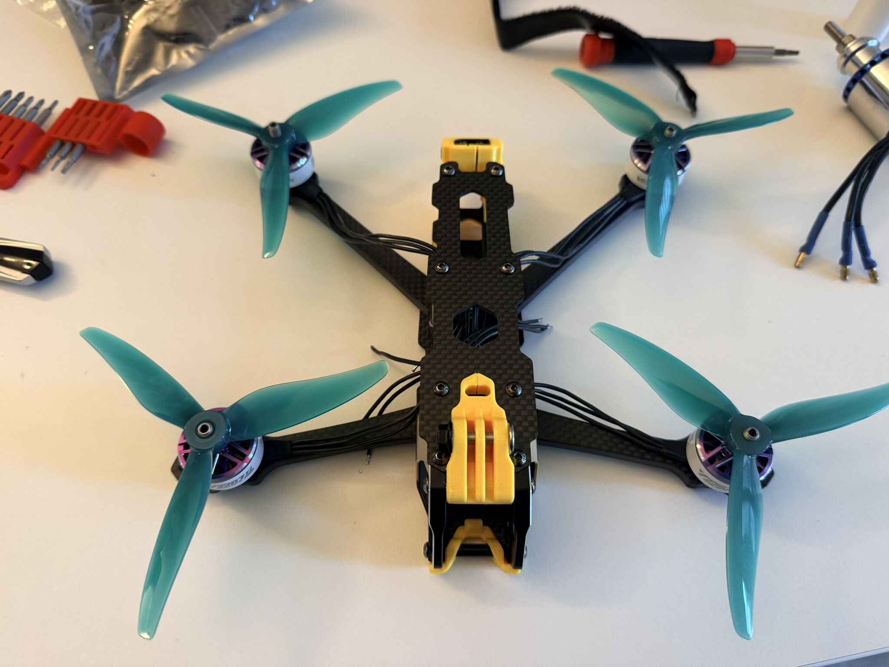

---
title: 'FPV Drone'
summary: 'Researching compatible components, soldering the electronics, and assembling an FPV drone from parts, followed by an attempt to add GPS waypoint navigation.'
date: 2026-08-01
tags: ['Electronics']
cover: './images/fpv-drone/assembled-drone.jpeg'
coverAlt: 'Assembled FPV quadcopter on a workbench with a carbon-fibre frame, teal three-blade propellers, and yellow mounts'
featured: true
---

## The project

Over the summer of 2026, I designed and built an FPV (first-person-view) drone from individual parts. I wanted to own the whole process: choosing compatible components, soldering the electronics, and assembling the finished aircraft.

## Research and component selection

I began by studying the parts typically used in FPV builds and how they work together. A key decision was pairing the right motors with the right propellers. I wanted longer flight times without giving up too much power, so I treated selection as a balance between endurance and performance.

This research turned a pile of separate parts into a coherent design, and it became just as important as the hands-on work that came after.

*All the parts laid out before assembly.*

## Soldering and assembly

I did all the soldering myself and assembled the drone, though I hadn't yet installed the FPV camera when I flew it. Handling both the electrical connections and the mechanical build gave me direct experience turning researched parts into a working aircraft.

The finished drone combined a carbon-fibre frame, four motors, propellers, and onboard electronics. Fitting everything into such a compact assembly taught me a lot about how the electrical and mechanical sides of a build depend on each other.

*The finished drone on my workbench.*

## GPS waypoint attempt and flight loss

Once the drone was built, I tried adding GPS so it could fly waypoint missions, extending the project from hardware into autonomous navigation.

During a flight at this stage, the FPV camera still wasn't installed, so I was tracking the drone by eye from the ground. I lost sight of its orientation, then lost control, and ultimately lost the drone. That ended the project before I could reach the waypoint goal.

## What I took away

This project taught me how to check component compatibility, balance flight time against power, solder electronics, and handle the mechanical and electrical assembly on my own. The GPS waypoint goal was left unfinished.

My biggest lesson was to avoid adding features before my skills were ready. Success with the build made me overconfident, and I let the drone fly too far out, lost track of its orientation, and lost it. I pushed toward advanced capabilities without enough flying experience. On a future build, I'll take more precautions, put more time into basic piloting, and only add new features once I can test them responsibly.
