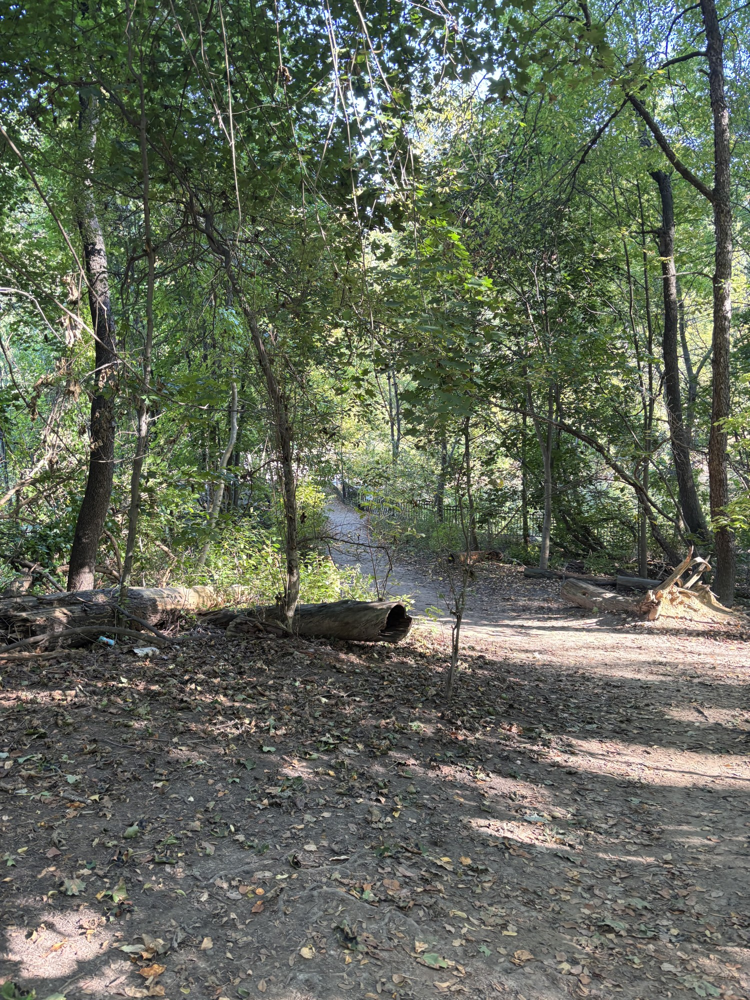
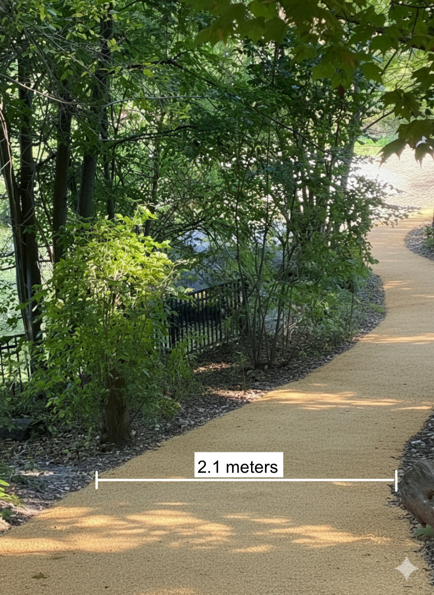
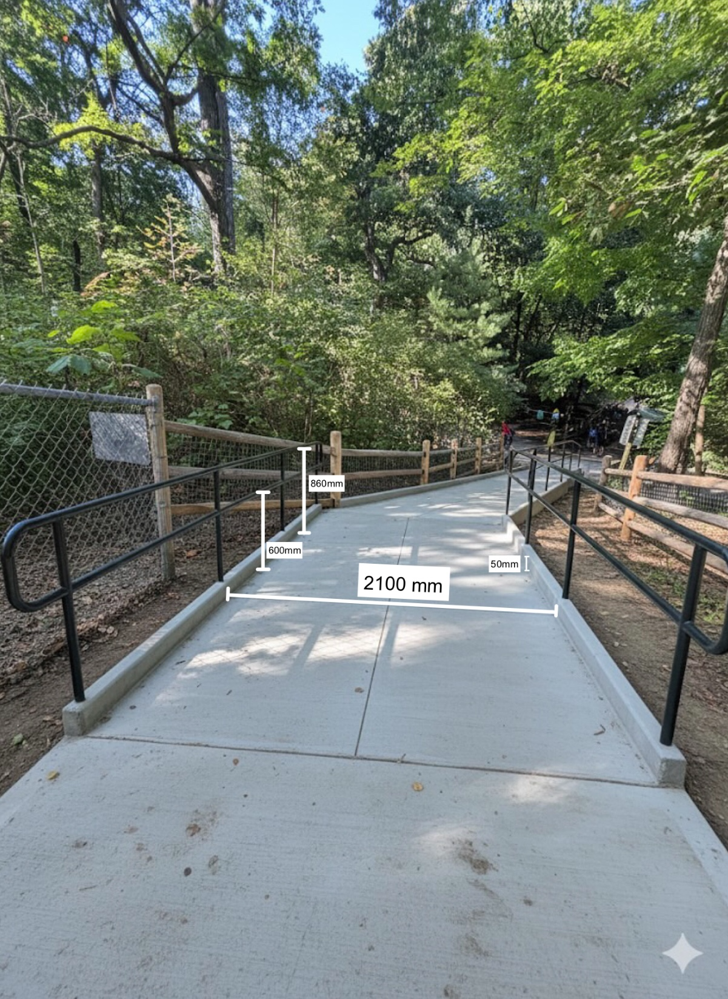

## The problem

For APS111: Engineering Strategies & Practice I, our five-person team explored how to improve access between Keele subway station and the High Park Nature Centre. The project asked us to balance accessibility with protection of the park's Black Oak Savannah ecosystem.

Our study focused on an approximately 605-metre route. The team's site visit documented steep slopes, loose ground, exposed roots, narrow sections, and damaged asphalt. These conditions created barriers for visitors with different mobility needs and made the existing path a useful starting point for defining the design problem.

*The existing trail during our site visit. Uneven surfaces and changes in slope helped inform the design requirements.*

## My role

I researched the people and organizations affected by the route and helped define the project's design objectives. This included looking into accessibility, trail design, environmental conservation, the Nature Centre's programs, and local residents' concerns.

I was responsible for all of the work on the stabilized decomposed-granite path with concrete ramps, from researching the concept to developing and documenting the proposal. I also contributed to editing and reviewing the team's reports. We took the site measurements together as a team during our visit to High Park.

## Turning observations into requirements

We organized the problem into functions, objectives, and constraints before comparing solutions. The route needed to help visitors reach the Nature Centre while accounting for year-round use, different mobility needs, environmental disturbance, cultural interpretation, and cost.

These priorities could conflict. Making a route easier to traverse might require more space or construction, while minimizing disturbance could limit how much of the existing terrain we changed. Defining the requirements gave us a basis for comparing those tradeoffs.

## Developing and comparing concepts

The team generated about 50 ideas, then used feasibility screening, multivoting, and a graphical decision chart to narrow them down. We developed three alternatives: an elevated boardwalk, a gondola, and a stabilized decomposed-granite path combined with concrete ramps.

My alternative proposed improving the existing trail surface with stabilized granite and adding ramps at steeper sections. The aim was to retain much of the existing route while improving surface consistency and managing elevation changes.

*AI-generated concept illustrations from our report showing the proposed granite surface and ramps. These visualize the design idea; they are not photographs of construction or tested prototypes.*

The granite-and-ramp concept had a lower estimated construction cost, but our comparison also identified concerns about freeze-thaw durability, winter maintenance, and the extra land needed for ramps and switchbacks. Those limitations mattered when comparing it with the elevated boardwalk.

## The team's recommendation

The report used a Pugh chart to compare the three alternatives and recommended the boardwalk. The concept combined elevated sections, switchbacks, resting areas, and helical-pile supports intended to reduce ground disturbance.

The final deliverable was our conceptual design report recommending the boardwalk. That marked the end of the course's scope, so we did not progress to a physical model, prototype, or construction.

## What I learned

The biggest lesson was that there are almost endless aspects of a design to consider, but limited time to work through them. Accessibility, environmental impact, maintenance, cost, and the needs of different users could each lead to more questions and research.

I learned how important it is to narrow those considerations down to a clear set of priorities. Defining the most important objectives helps direct the team's effort toward meeting them well, instead of spending too much time on details that have less influence on the outcome. For future projects, I would establish those priorities early and use them to decide where further research and design work would be most valuable.
