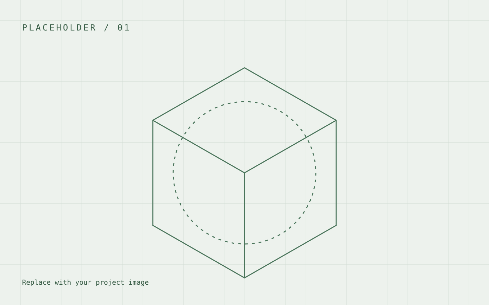

> This is sample structure only, not a real project. Replace all text and images with your own work.

## Overview

Describe the problem, your role, and the goal of the project in a few sentences.

## Requirements & constraints

- Add a requirement and explain why it mattered.
- Identify the constraints that shaped your decisions.
- Distinguish your contributions from the team's work.

## Approach

Explain your process. Include sketches, calculations, prototypes, or trade-offs where they help tell the story.

### A comparison table

| Criterion | Option A | Option B |
| --- | --- | --- |
| Your criterion | Your observation | Your observation |
| Another criterion | Your observation | Your observation |

## Results & reflection

Add your actual findings, supporting evidence, limitations, and what you would change next time. Do not include unverified performance claims.
