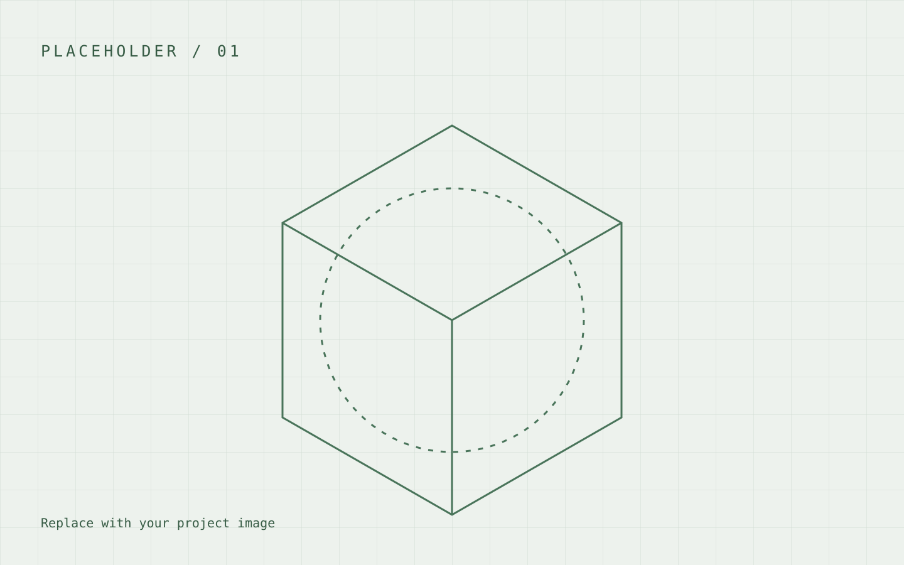
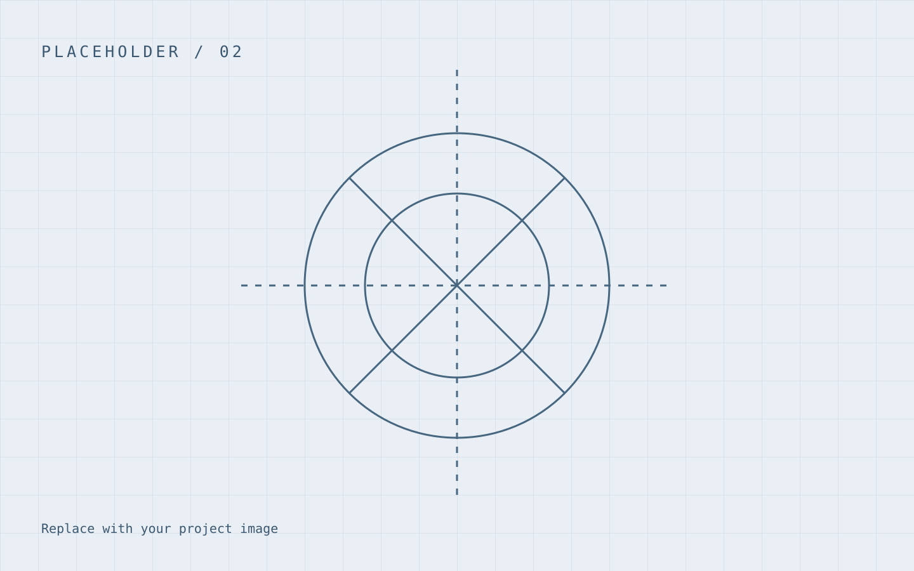

> This is a placeholder, not a real project. The examples below demonstrate formatting only.

## The question

State what you wanted to investigate and what a successful result would look like.

## Method

Describe your setup and explain why you chose it. Use code blocks for short snippets:

```python
# Formatting example only: replace with code from your own work.
measurements = []
for measurement in measurements:
    print(measurement)
```

## Image gallery

<div class="gallery">





</div>

## Supporting files

Put downloads in `public/files/`, then link to them with Markdown. This working example uses a text file; PDFs, CAD files, and ZIPs work the same way:

[Download the placeholder attachment](/files/placeholder.txt)

## Results

Replace this paragraph with your observations, limitations, and next steps.
