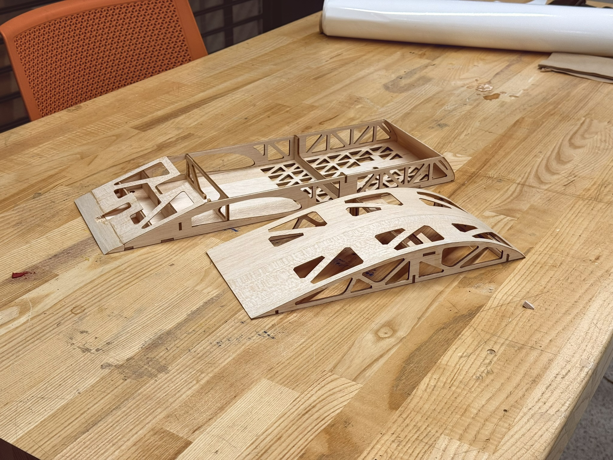
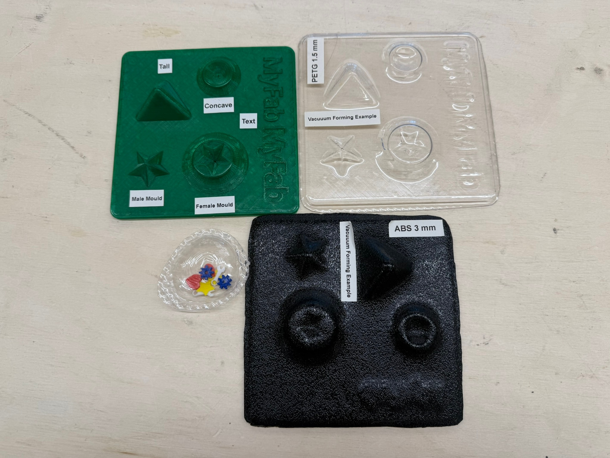

## Joining the Structures team

I joined UTAT UAS SAE's Structures subteam at the start of my first year of engineering. The team was a natural fit for my interests in remote-controlled vehicles, aviation, and autonomous vehicles.

Our subteam is responsible for the fuselage, landing gear systems, payload pickup and drop-off mechanism, and the interfaces connecting the fuselage to the wings and tail. My work has included preparing manufacturing files, assembling and repairing fuselages, investigating alternative manufacturing methods, and designing and analyzing components for our next aircraft.

This page follows my contributions from **UT26 Maple**, our 2025–26 aircraft, through summer 2026 research and ongoing development for **UT27 Aurora**. The completed aircraft pictured above is Maple.

- [UT26 Maple: manufacturing and flight testing](#ut26-maple-manufacturing-and-flight-testing)
- [Summer 2026: fuselage manufacturing research](#summer-2026-fuselage-manufacturing-research)
- [UT27 Aurora: trailing-edge spar analysis](#ut27-aurora-trailing-edge-spar-analysis)
- [UT27 Aurora: arming plug mount](#ut27-aurora-arming-plug-mount)

## UT26 Maple: manufacturing and flight testing

Maple was the team's second attempt at the SAE Aero Advanced class during the 2025–26 competition cycle. I prepared laser-cut templates in SolidWorks and AutoCAD for MyFab, the university's in-house fabrication facility, and manufactured multiple versions of the fuselage by assembling and gluing the laser-cut balsa parts.

*Fuselage construction for UT26 Maple, showing the internal framing and curved upper section.*

### Making the interfaces fit

During manufacturing, I helped diagnose problems at the wing–fuselage interface. Manufacturing errors caused components to misalign, preventing parts from fitting together as intended. I identified these issues and modified the fuselage to accommodate the alignment differences.

I also attended multiple flight tests and carried out on-site fuselage repairs after crashes. Working on both assembly and repairs gave me direct experience with the fragility of the balsa structure and the practical consequences of manufacturing tolerances. These experiences helped motivate our subsequent research into other ways to manufacture the fuselage.

## Summer 2026: fuselage manufacturing research

After the 2025–26 school year and competition cycle, I investigated alternatives to the laser-cut wooden fuselage. We wanted to explore whether a plastic structure could better withstand crash damage while simplifying assembly and reducing sources of manufacturing error and tolerance accumulation.

### Comparing the alternatives

I researched material properties for balsa, basswood, plywood, ABS, and PETG, considering weight and structural performance. Maple's fuselage was made from **balsa**; **basswood was another material studied in the comparison**.

We considered both 3D printing and vacuum forming. OrcaSlicer mass estimates indicated that the printed fuselage options we considered would be substantially heavier than balsa. Vacuum forming appeared promising as a way to produce more repeatable parts with fewer assembly steps, so I investigated the materials and equipment available at MyFab.

*Existing MyFab demonstration samples examined during the study; these were not parts I manufactured.*

### Findings and recommendation

The study identified several constraints:

- MyFab's available vacuum-forming materials were ABS and PETG. The material data I reviewed showed a less favorable stiffness-to-weight comparison with basswood, one of the wood alternatives studied.
- The equipment could not form an entire fuselage in one piece. A plastic fuselage would require sections and joints, adding structural and assembly considerations.
- The surface finish of the ABS examples raised concerns for surfaces that needed to be smooth, making mould design another consideration.

The study supported retaining wood given the weight and stiffness tradeoffs, equipment limitations, and the team's existing experience with assembling laser-cut fuselages. The potential benefits of plastic did not justify changing our manufacturing approach at that stage.

## UT27 Aurora: trailing-edge spar analysis

For Maple, a piece extending from the wing engaged a cutout in the fuselage to resist wing rotation. This interface was heavy and difficult to align during assembly. For Aurora, the team investigated using the trailing-edge spar to resist rotation about the main spar, with the aim of simplifying the interface and reducing weight.

### Turning wing loads into a sizing comparison

I used loads from the Aerodynamics subteam's wing multidisciplinary design optimization (MDO) work as inputs to a Python sizing script. The script converted the torsional loading into loading on the trailing-edge spar, then calculated shear forces and bending moments along the spar.

The comparison swept through balsa, basswood, aircraft plywood, and woven carbon-fibre sheet at different thicknesses and cross-section heights. It calculated bending and shear stresses, included a buckling check, and compared margins with an assumed factor of safety of 1.5 alongside estimated spar mass.

### Outcome

The analysis indicated that the team's planned 1/8-inch balsa option was adequate under the analyzed loading assumptions. This supported using the existing material choice for the proposed interface rather than adding a heavier solution. This result is an analytical sizing conclusion; physical validation is a separate step.

## UT27 Aurora: arming plug mount

*Ongoing development*

I am designing a mount that attaches to Aurora's fuselage and holds two XT60 arming plugs above it. The larger propellers on the new aircraft drive the need for an elevated mounting position to provide clearance. The mount also serves as the clamp holding the tail boom in place.

### Iterating through printed prototypes

| Version | Design and reason for the change |
| --- | --- |
| V1 | A fully 3D-printed mount enclosing the wires running up to the arming plugs. Its weight prompted a redesign. |
| V2 | Replaced the middle section with a single 6 × 6 mm carbon tube to reduce weight while retaining printed mounting components. |
| V3 | Refined the CAD construction and geometry to make the design cleaner and easier to modify. |

All three versions have been printed and weighed. Development is continuing as I refine the design for integration with Aurora.

<!-- Add matching CAD views, measured prototype masses, and spar results when supplied. -->
